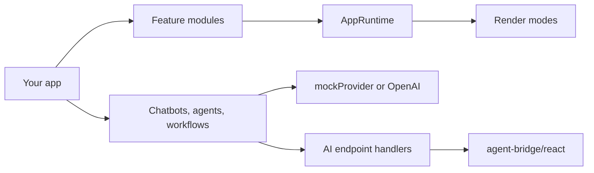

# AgentBridge

TypeScript framework for AI web apps that keeps routes, render modes, and model calls in one place, and runs offline with a mock provider.

[Documentation](docs.md) · [Contributing](CONTRIBUTING.md) · [Examples](examples/README.md) · [Code of conduct](CODE_OF_CONDUCT.md)

Licensed under [Apache-2.0](LICENSE).

## Architecture



Feature modules declare a route and a render mode (`server`, `client`, `static`, `incremental`, `hybrid`). AI definitions talk to a provider. `mockProvider` is built in, so the core works without an API key. React hooks and components are a separate entry so the core package does not depend on React.

## Install

```bash
npm install agent-bridge
```

Node.js 18 or newer. React 18 or newer is an optional peer dependency, used only by `agent-bridge/react`.

## Hello world

No API key:

```ts
import { defineChatbot, mockProvider } from "agent-bridge";

async function main() {
  const bot = defineChatbot({ name: "hello", model: "mock", instructions: "Reply briefly.", provider: mockProvider });
  console.log(await bot.run("Hello"));
}

main();
```

From a clone of this repository:

```bash
npm install
npm test
npm run dev
```

`npm run dev` runs [examples/hello.ts](examples/hello.ts). More starters are in [examples/](examples/README.md): a support chatbot, a tool-calling agent, local retrieval, and a workflow. [examples/basic.ts](examples/basic.ts) calls OpenAI and reads `OPENAI_API_KEY` from the environment.

## Configuration

```bash
cp .env.example .env
```

Set `OPENAI_API_KEY` only when you use the OpenAI provider. `.env` is listed in `.gitignore`. The published package does not include it.

## Develop

```bash
npm run lint
npm run typecheck
npm test
npm run build
```

Pull requests run those checks in GitHub Actions. See [CONTRIBUTING.md](CONTRIBUTING.md).

## Status

This is a 0.1 release. The CLI commands (`create`, `dev`, `build`, `start`, `generate`) print scaffolds and do not write an application yet. The deeper usage guide is [docs.md](docs.md).
